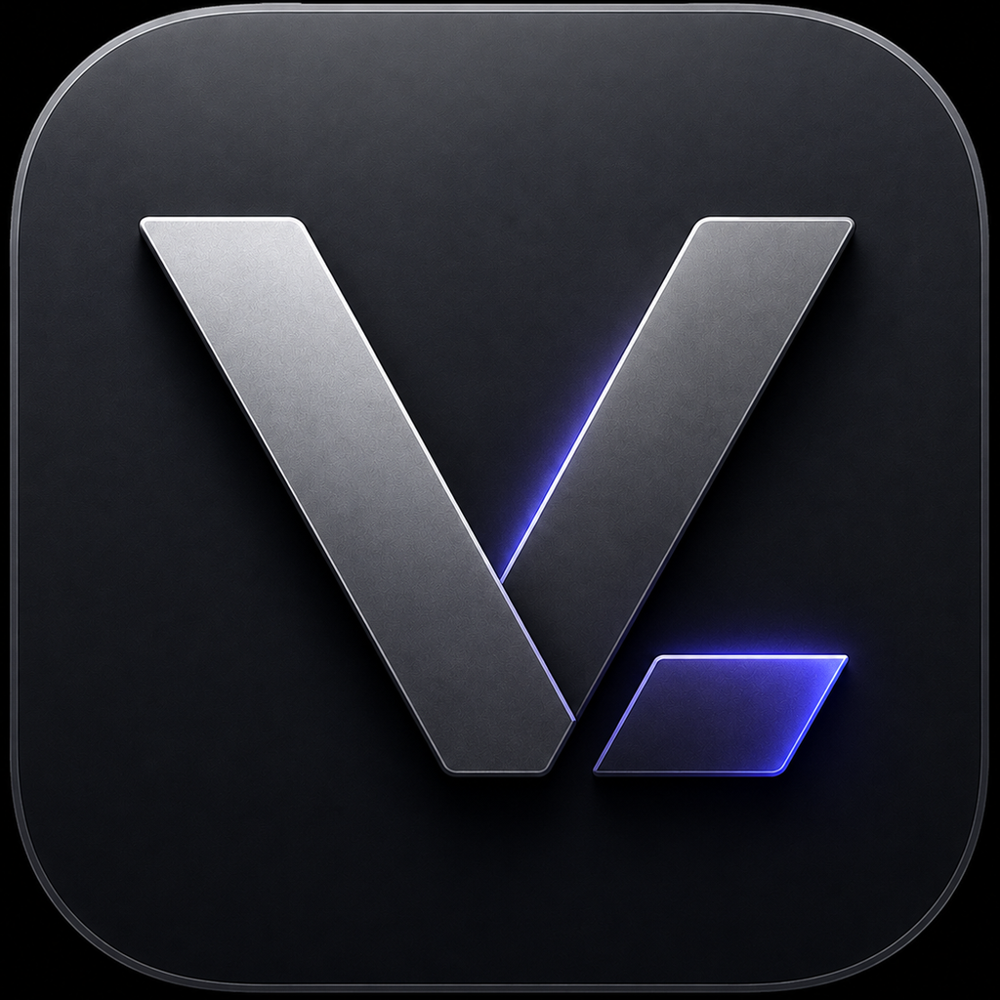
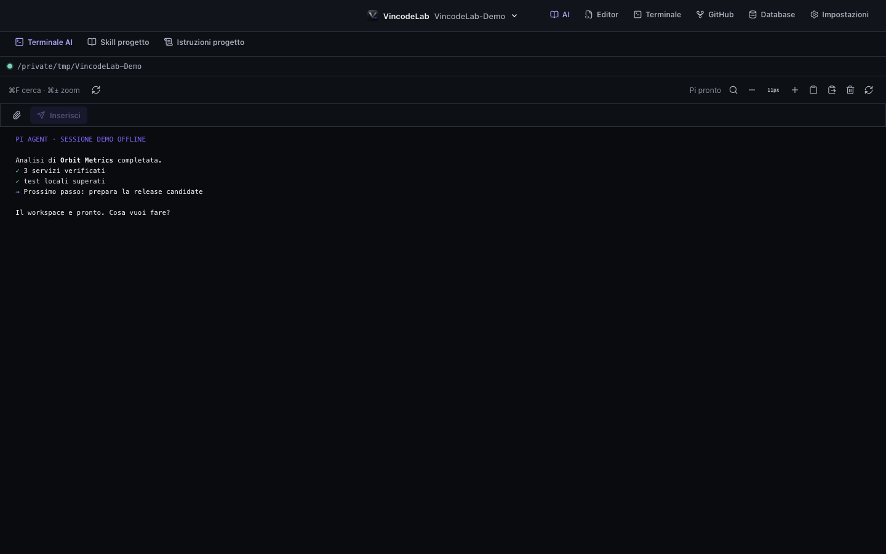
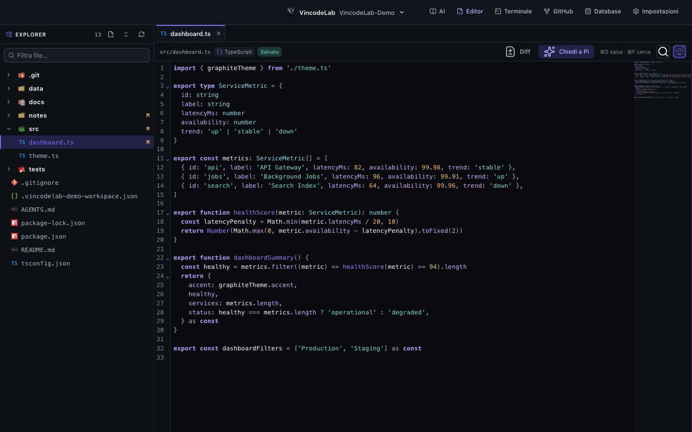
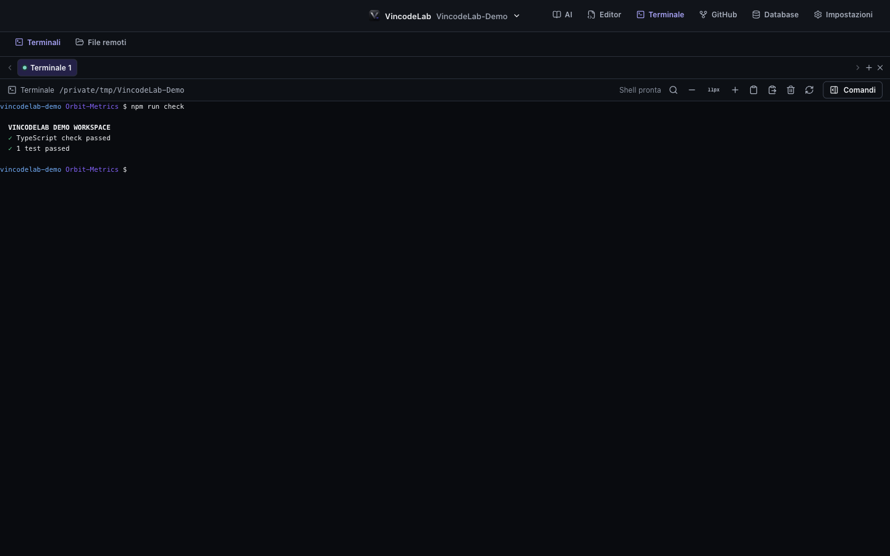
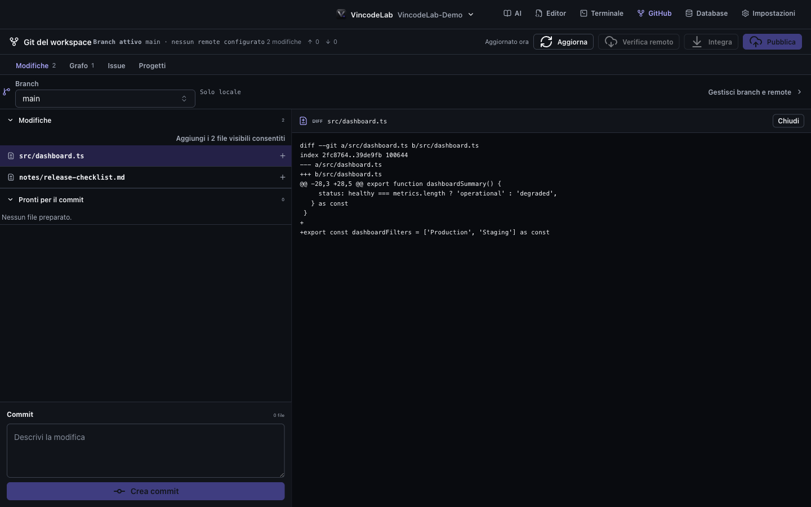
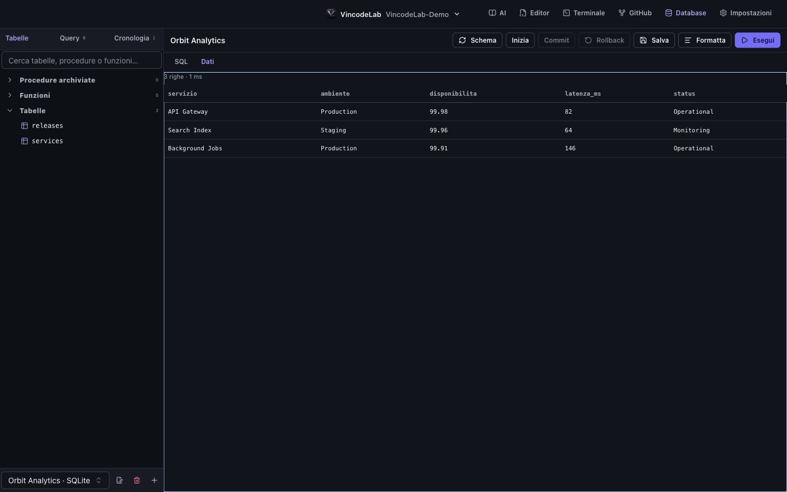

# VincodeLab

<p align="center">
  
</p>

<p align="center">
  Un workbench macOS per lavorare su codice, terminali, Pi Coding Agent, GitHub, database e Redis senza cambiare applicazione.
</p>

> [!IMPORTANT]
> VincodeLab è in sviluppo attivo. Al momento non vengono distribuiti binari pubblici firmati o notarizzati: l'applicazione si esegue dal sorgente oppure si crea localmente un pacchetto non firmato.

## Panoramica

VincodeLab apre una cartella locale come workspace e mantiene editor, terminali, contesto AI, stato Git e strumenti dati nello stesso ambiente. L'interfaccia Graphite è costruita con React, primitive Ark UI, componenti Park UI mantenuti localmente e Panda CSS; Electron confina filesystem, processi e integrazioni native dietro un preload esplicito.



### Funzionalità disponibili

- **Workspace persistenti:** apertura cartella, elenco dei recenti, ripristino di navigazione, tab e layout, palette comandi e Quick Open.
- **Pi Coding Agent:** terminale AI xterm, skill e istruzioni di progetto, gestione dei pacchetti Pi e invio del contesto dall'editor.
- **Editor:** CodeMirror 6, explorer, tab, ricerca, minimappa, salvataggio e anteprime per Markdown, CSV, immagini e PDF.
- **Terminali:** più sessioni shell per workspace, ripristino del layout, ricerca, cronologia, zoom e comandi riutilizzabili.
- **Git e GitHub:** stato, diff, staging, commit, branch, fetch, pull con rebase, push, grafo, issue e GitHub Projects del repository corrente.
- **Database:** connessioni SQLite, PostgreSQL, MySQL e SQL Server, schema explorer, editor SQL, cronologia, query salvate, transazioni e modifica controllata delle righe.
- **Redis:** connessioni Standalone e Sentinel isolate per workspace, browser incrementale delle chiavi, inspector read-only per i tipi principali e ricerca cancellabile nei payload con limiti espliciti.
- **File remoti:** sessioni SSH basate su OpenSSH, esplorazione SFTP, cache locale, confronto delle modifiche e sincronizzazione esplicita.
- **Esperienza di errore:** errori confinati alla vista, messaggi contestuali, azioni di recupero, deduplicazione e diagnostica sanitizzata con correlation ID.

<table>
  <tr>
    <td width="50%"></td>
    <td width="50%"></td>
  </tr>
  <tr>
    <td align="center"><strong>Editor</strong></td>
    <td align="center"><strong>Terminali</strong></td>
  </tr>
  <tr>
    <td></td>
    <td></td>
  </tr>
  <tr>
    <td align="center"><strong>Git e GitHub</strong></td>
    <td align="center"><strong>Database</strong></td>
  </tr>
</table>

Gli screenshot usano esclusivamente il [workspace dimostrativo](docs/screenshots.md), senza repository reali, credenziali o dati personali.

## Requisiti

Per sviluppare o creare il pacchetto locale servono:

- macOS; il flusso corrente è verificato su Apple Silicon;
- Node.js `>=22.12.0 <27` (Node.js 24 è la versione consigliata in `.node-version`);
- npm `>=10.9.0 <12` (il lockfile dichiara npm `11.12.1`);
- Git;
- gli strumenti da riga di comando Xcode se non è disponibile un binario precompilato per i moduli nativi.

Le integrazioni seguenti sono opzionali:

- [Pi Coding Agent](https://pi.dev/) per il Terminale AI;
- [GitHub CLI](https://cli.github.com/) autenticata per issue e GitHub Projects;
- OpenSSH, incluso normalmente in macOS, per SSH e SFTP;
- un server compatibile per PostgreSQL, MySQL, SQL Server o Redis. SQLite funziona con un file locale.

L'assenza di uno strumento opzionale disabilita la relativa integrazione, non l'intera applicazione.

### Pacchetto installato su un Mac pulito

Il bundle `.app` include Electron, il runtime Node usato internamente, il componente PTY, i driver SQL e il client Redis. Sul computer di destinazione **non** occorre installare Node.js, npm, `redis-cli`, `sqlite3`, `psql`, `mysql`, `sqlcmd`, ODBC o `libpq` per avviare VincodeLab.

Pi, Git, GitHub CLI e OpenSSH/SFTP restano integrazioni opzionali. Il Terminale AI avvia Pi direttamente nel workspace corrente. In **Impostazioni → Compatibilità** l'app distingue i componenti inclusi dagli strumenti esterni e spiega quale sola funzione viene disattivata quando uno di essi manca. Consulta la [matrice runtime e recovery](docs/runtime-compatibility.md) per i dettagli.

## Avvio dal sorgente

```bash
git clone https://github.com/dimaurovincenzo/VincodeLab.git
cd VincodeLab
npm ci
npm run dev
```

`npm run dev` avvia Vite sulla sola interfaccia loopback e apre Electron quando il renderer è pronto.

## Verifica e build

Esegui il gate completo prima di proporre una modifica:

```bash
npm run check
```

Il comando esegue, nell'ordine, igiene del repository, regole architetturali, parità del preload, lint, audit CSS, test Node, test dei componenti e infine type-check con build di produzione.

Per creare localmente `.app`, DMG e ZIP macOS:

```bash
npm run package
```

Il pacchetto prodotto è intenzionalmente **non firmato** (`build.mac.identity` è `null`) e destinato allo sviluppo o al collaudo locale. Consulta la [guida build e release](docs/release.md) prima di preparare una distribuzione pubblica.

## Architettura in breve

```text
React renderer
      │ @/bridge (unico accesso a window.vincodeLab)
      ▼
preload isolato ── IPC validato ──► Electron main
                                      ├─ filesystem e workspace
                                      ├─ PTY, Pi e OpenSSH/SFTP
                                      ├─ Git e GitHub CLI
                                      └─ database, Redis e persistenza locale
```

- Il renderer è TypeScript/React, non accede direttamente a Node.js e usa `window.vincodeLab` esclusivamente attraverso l'ingresso pubblico `@/bridge` (`src/bridge/`).
- Il preload espone una superficie nominata tramite `contextBridge`.
- Il processo principale valida il mittente e gli argomenti prima delle operazioni privilegiate.
- Dati applicativi e log restano nelle directory utente di Electron; le password database e Redis vengono protette con `safeStorage` quando disponibile.

La [documentazione dell'architettura](docs/architecture.md) descrive confini, directory e flussi con maggiore precisione.

## Documentazione

- [Indice della documentazione](docs/README.md)
- [Architettura](docs/architecture.md)
- [Ambiente di sviluppo](docs/development.md)
- [Strategia di test](docs/testing.md)
- [Build e release](docs/release.md)
- [Compatibilità runtime e recovery](docs/runtime-compatibility.md)
- [Linee guida per gli screenshot](docs/screenshots.md)
- [Contribuire](CONTRIBUTING.md)
- [Sicurezza](SECURITY.md)

## Contribuire

Issue e pull request focalizzate sono benvenute. Prima di intervenire, leggi [CONTRIBUTING.md](CONTRIBUTING.md): contiene convenzioni del progetto, confini Electron/IPC e checklist di verifica.

Per una vulnerabilità, non aprire una issue pubblica; segui invece [SECURITY.md](SECURITY.md).

## Licenza

VincodeLab è distribuito con licenza [MIT](LICENSE).
